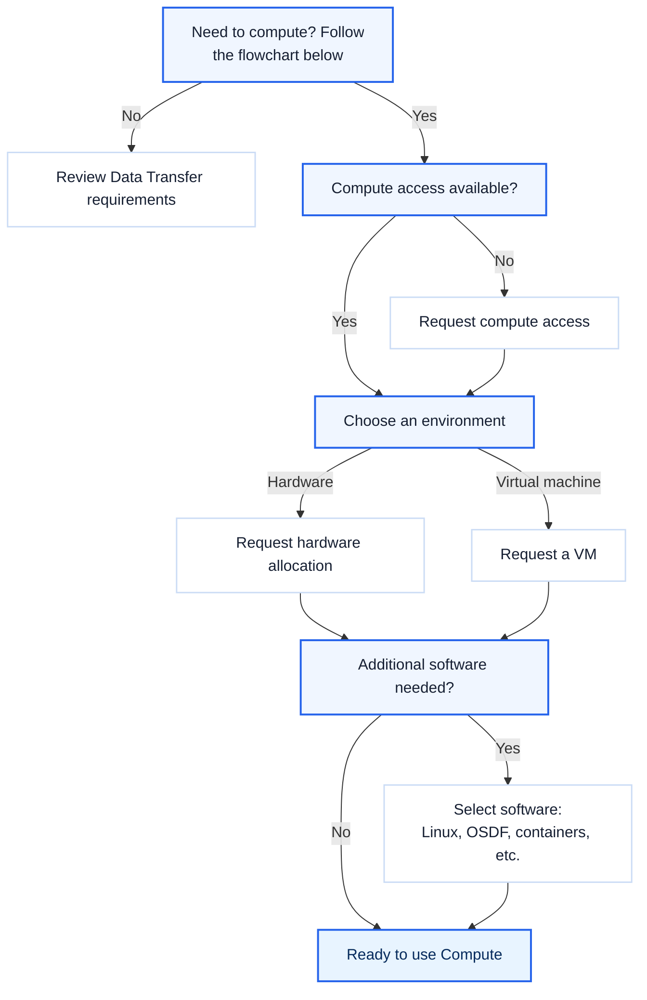

 User Services

    
 This page defines the conditions and requirements for User Services. Choose either Compute or Storage Use Cases and
    follow its instructions to identify the resources needed. 

<section class="use-case-grid" aria-label="Choose a use case">
    <a class="use-case-card" href="#Compute-Requirements">
        1.
        <h2>Compute</h2>
        
 Determine access, environment, and software needed for Compute work.

        View Compute Requirements →
    </a>
    <a class="use-case-card" href="#Storage-Requirements">
    2.
    <h2>Storage</h2>
    
Identify the access and tools needed to use research data.

    View storage requirements →
  </a>
</section>

<!-- Compute Requirements Section -->
<section class="requirements-section" id="Compute-Requirements">

1 · Compute Use-Case path

  <h2>Compute requirements</h2>
  

    Determine access, environment, and software needed for Compute work.
  

  

    

      <h3>Compute eligibility guide</h3>
      
Answer each question to find the appropriate next step.

    

  

</section>

<aside class="requirements-help">
    

      Any Additional Questions about Requirements? <a href="https://nationalsciencedatafabric.org/contact/" target="_blank" rel="noreferrer">Contact NSDF support</a>.
    

</aside>

<!-- Storage Requirements Section -->
<section class="requirements-section" id="Storage-Requirements">
  
2 · Storage Use-Case path

  <h2>Storage requirements</h2>
  

    Use this guide to determine the access and transfer method needed for your data.
  

  

    

      <h3>Storage eligibility guide</h3>
      
Answer each question to identify your recommended next step.

    

  

</section>

<aside class="requirements-help">
    

      Any Additional Questions about Requirements? <a href="https://nationalsciencedatafabric.org/contact/" target="_blank" rel="noreferrer">Contact NSDF support</a>.
    

</aside>