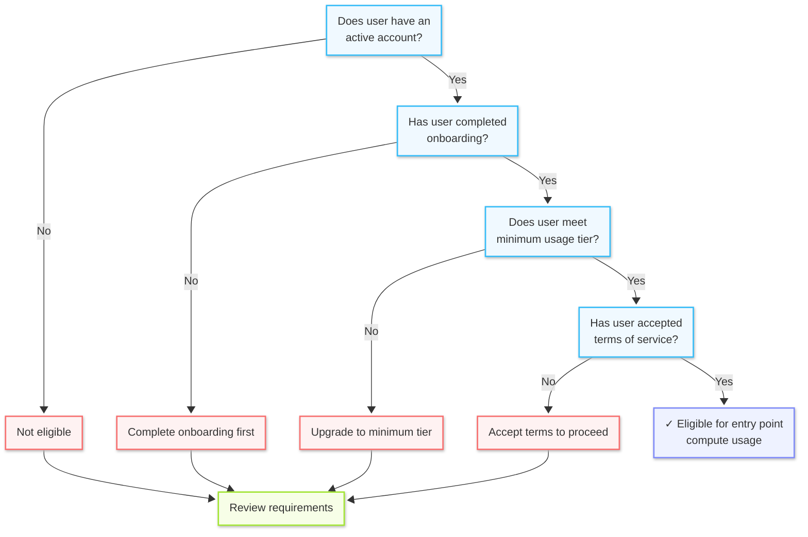

This page defines conditions for User Services, both for **Compute** and **Storage** use cases.

## Find your use case

# Compute Use Case #
Insert tree or link here....

# Storage Use Case #
Insert tree or link here...